# CareQueue: Clinic Appointments & Patient Queue

CareQueue runs the front desk of a small outpatient clinic. Reception books patients into a doctor's
time slots, every booking gets a **token number**, and on the day the waiting room runs from a
**live queue**: check the patient in, call them in, complete the visit. Double bookings, past slots
and invalid status changes are rejected by the API and by the database.

This repository is my DevOps final capstone: the application plus the full DevOps layer around it
(Git → CI → security scans → container registry → Terraform/AWS → Kubernetes → Helm → Ingress →
autoscaling → monitoring → troubleshooting).

**Author:** Rudhar Bajaj (`rudhar07`) · **Repo:** https://github.com/rudhar07/carequeue-clinic

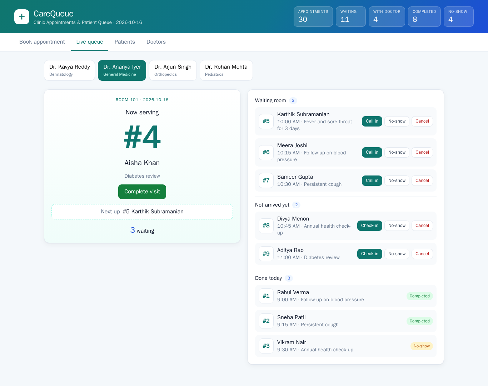

---

## Contents

1. [Architecture](#1-architecture)
2. [The application](#2-the-application)
3. [Run it locally (Docker Compose)](#3-run-it-locally-docker-compose)
4. [Tests](#4-tests)
5. [CI/CD pipeline](#5-cicd-pipeline)
6. [Security scanning (Trivy and friends)](#6-security-scanning)
7. [Terraform: AWS VPC + EKS](#7-terraform-aws-vpc--eks)
8. [Kubernetes + Helm](#8-kubernetes--helm)
9. [Monitoring: Prometheus + Grafana](#9-monitoring-prometheus--grafana)
10. [Troubleshooting lab](#10-troubleshooting-lab)
11. [Rubric map (M1–M10)](#11-rubric-map)
12. [Repository layout](#12-repository-layout)

---

## 1. Architecture

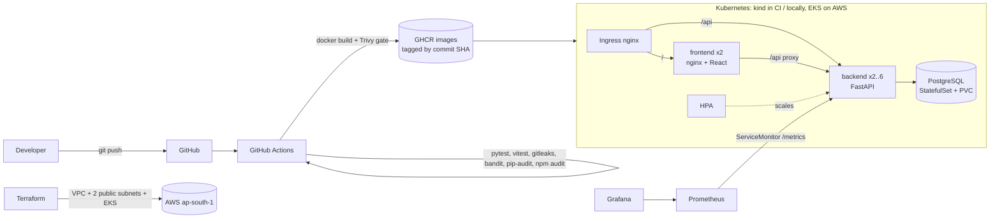

| Layer | Technology |
|---|---|
| Frontend | React 18 + Vite, served by `nginx-unprivileged`, which also proxies `/api` |
| Backend | Python 3.13, FastAPI, SQLAlchemy 2, Alembic, Pydantic v2 |
| Database | PostgreSQL 17 (SQLite in-memory in tests) |
| Containers | Docker, multi-stage frontend build, non-root images |
| CI/CD | GitHub Actions → GHCR (`ghcr.io/rudhar07/carequeue-backend` / `-frontend`, SHA tags) |
| Security | Trivy (images + IaC), Gitleaks, Bandit, pip-audit, npm audit |
| Infrastructure | Terraform: VPC + EKS (`terraform-aws-modules`), region `ap-south-1` |
| Orchestration | Kubernetes, Helm chart `helm/carequeue`, ingress-nginx, HPA, metrics-server |
| Observability | kube-prometheus-stack (Prometheus, Alertmanager, Grafana), custom dashboard |

## 2. The application

Full details: [docs/APP.md](docs/APP.md).

- **Doctors:** specialty, room, consulting hours and slot length.
- **Patients:** Indian mobile number, normalised and unique.
- **Appointments:** a doctor, a date and a slot on the doctor's grid. Each one gets a per-day token,
  and its status moves `booked → checked_in → in_consultation → completed`. It can also become
  `cancelled` or `no_show`.
- **Rules:**
  - No double booking: a 409, enforced in code and by a partial unique index.
  - No past or off-grid slots (422), and no bookings with inactive doctors (409).
  - Status changes are validated (409 if not allowed), and only one patient per doctor can be in
    consultation at a time.

| Method | Endpoint | Purpose |
|---|---|---|
| GET/POST | `/api/doctors` | list / add doctors |
| GET/PUT/DELETE | `/api/doctors/{id}` | read / update / delete (deactivates if it has history) |
| GET | `/api/doctors/{id}/slots?date=` | free and booked slot grid |
| GET/POST | `/api/patients` (`?q=` search) | list / register patients |
| GET/PUT/DELETE | `/api/patients/{id}` | read / update / delete |
| GET/POST | `/api/appointments` (filters) | list / book |
| GET/PUT/DELETE | `/api/appointments/{id}` | read / reschedule / delete |
| PATCH | `/api/appointments/{id}/status` | check in, call in, complete, no-show, cancel |
| GET | `/api/queue?doctor_id=&date=` | live queue: now serving, next up, waiting |
| GET | `/api/stats/today` | today's counts for the header |
| GET | `/health`, `/ready`, `/metrics`, `/api/info` | liveness, readiness (checks DB), Prometheus, build info |

| Book appointment | Patients | Mobile (390 px) |
|---|---|---|
| 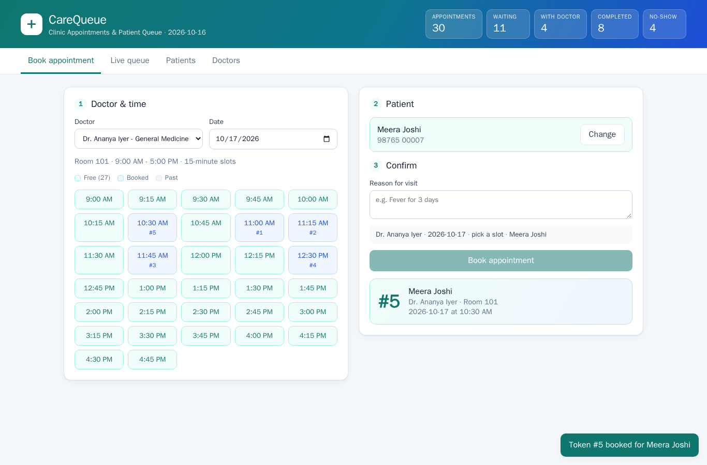 | 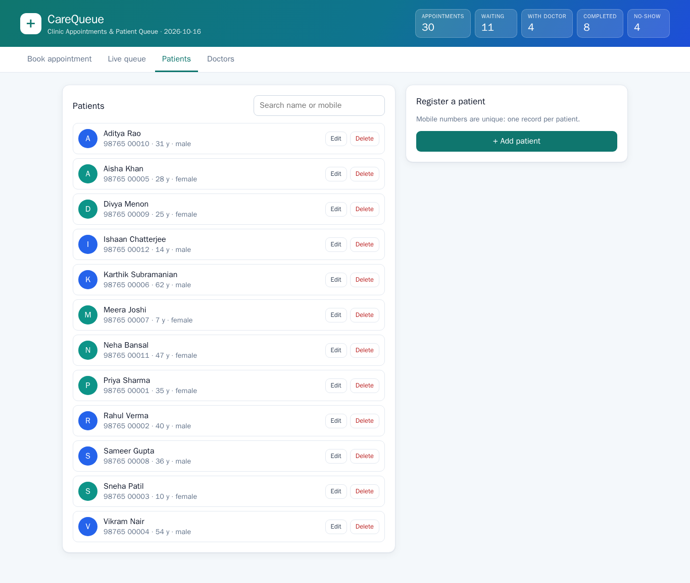 | 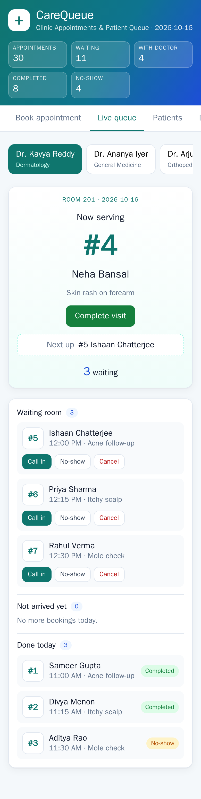 |

## 3. Run it locally (Docker Compose)

```bash
docker compose up --build
```

This starts PostgreSQL, then the backend (it runs the Alembic migration and seeds demo doctors and
patients), then the frontend on **http://localhost:3000**. No `.env` is needed; `.env.example`
documents the variables, and all its values are obviously fake demo values. Port 3000 can be
changed with `FRONTEND_PORT=3001 docker compose up --build`.

Evidence: [05-compose-up.txt](docs/evidence/05-compose-up.txt) (all 3 services healthy),
[06-api-flow.txt](docs/evidence/06-api-flow.txt) (full booking flow through the nginx proxy),
[07-nonroot.txt](docs/evidence/07-nonroot.txt) (backend uid 10001, frontend uid 101),
[11-compose-localhost-3000.txt](docs/evidence/11-compose-localhost-3000.txt) (`docker compose ps` and `/api/info` through :3000).

| `http://localhost:3000` (compose): live queue | booking |
|---|---|
| 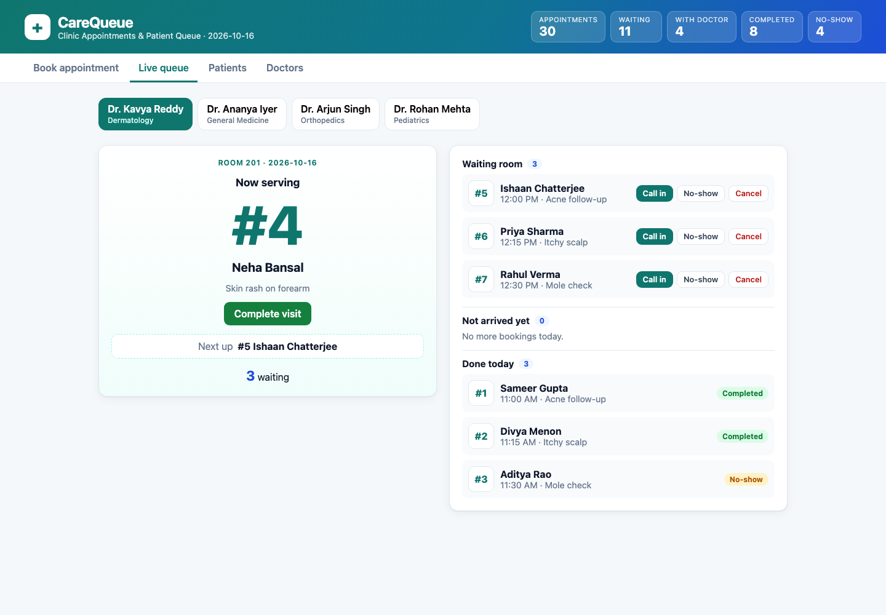 | 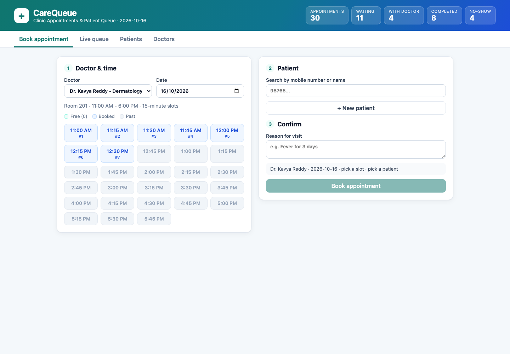 |

## 4. Tests

```bash
cd backend && pip install -r requirements-dev.txt && pytest -v
cd frontend && npm ci && npm test -- --run
```

- **Backend:** 52 pytest tests across doctors, patients, appointments, queue/stats, system and
  migrations. They use an in-memory SQLite test DB, never the real database (`tests/conftest.py`),
  and coverage is 96% with an 80% minimum enforced in `pytest.ini`.
- **Frontend:** 11 Vitest + Testing Library tests.

Evidence: [10-pytest-v.txt](docs/evidence/10-pytest-v.txt) (`pytest -v` at `1c1def4`: 52 passed, 96.12%),
[01-pytest.txt](docs/evidence/01-pytest.txt) (first run), [02-frontend-build-test.txt](docs/evidence/02-frontend-build-test.txt).

<details><summary><code>pytest -v</code> screenshot</summary>

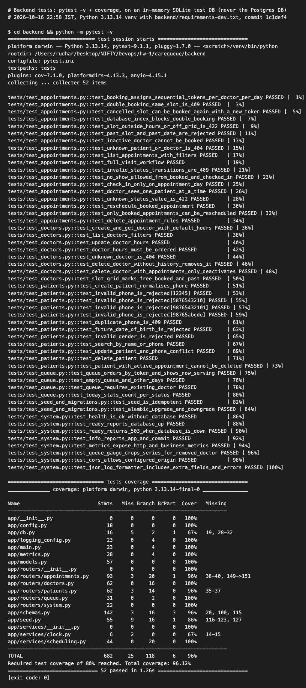
</details>

## 5. CI/CD pipeline

Workflow: [.github/workflows/ci-cd.yml](.github/workflows/ci-cd.yml). It runs on every push and pull
request to `main`, plus manual dispatch. Details: [docs/CICD.md](docs/CICD.md).

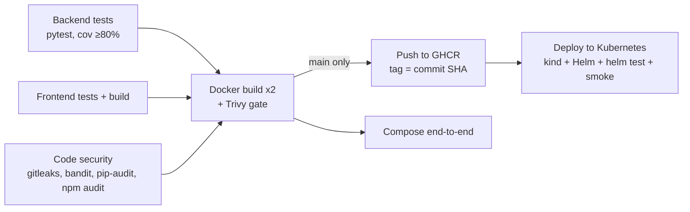

- A failing test fails the build (shown locally in [ci-04](docs/evidence/ci-04-test-and-build-local.txt)).
- Images are tagged **only** with the full commit SHA, never `latest`, and pushed with
  `GITHUB_TOKEN`.
- The deploy job installs the Helm chart on a fresh kind cluster, pulls the just-pushed images from
  GHCR, runs `helm test`, and checks that `/api/info` reports the same commit SHA as the pipeline.

**First pipeline run:** https://github.com/rudhar07/carequeue-clinic/actions/runs/38925851654.
It was green first time, all 7 jobs, for commit `beb400a`.

| Job | Result |
|---|---|
| Backend tests (pytest + coverage) | success |
| Frontend tests + build | success |
| Code security (gitleaks, bandit, pip-audit, npm audit) | success |
| Docker backend (build, Trivy, push) | success: `ghcr.io/rudhar07/carequeue-backend:beb400ab4aec494aa317c14a75f09ec047740d0d` |
| Docker frontend (build, Trivy, push) | success |
| Compose end-to-end (booking flow through nginx) | success |
| Deploy to Kubernetes (kind + Helm) | success: `helm test` passed, and the deployed `/api/info` reported `GIT_SHA beb400ab…` |

**Latest run:** https://github.com/rudhar07/carequeue-clinic/actions/runs/38937999333 (commit
`1c1def4`, all 7 jobs green). The images for both commits are in GHCR, tagged with the full SHA:
[carequeue-backend](https://github.com/users/rudhar07/packages/container/package/carequeue-backend),
[carequeue-frontend](https://github.com/users/rudhar07/packages/container/package/carequeue-frontend).

| Green run (`1c1def4`) | Run history |
|---|---|
| 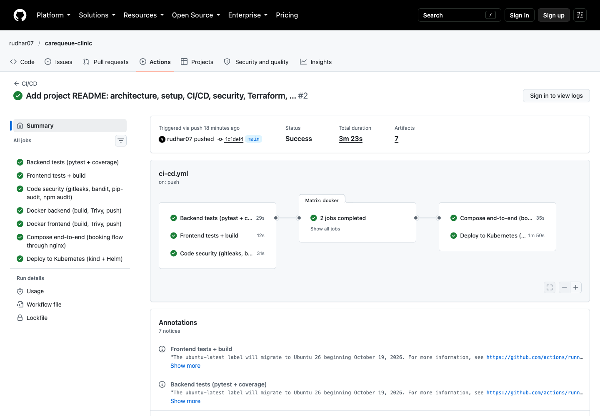 | 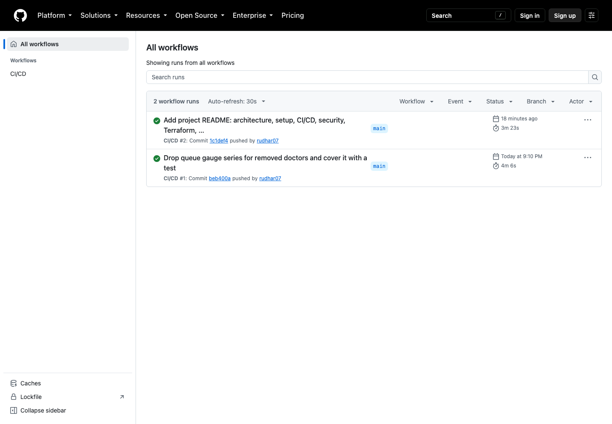 |

| GHCR backend: SHA tags | GHCR frontend: SHA tags |
|---|---|
| 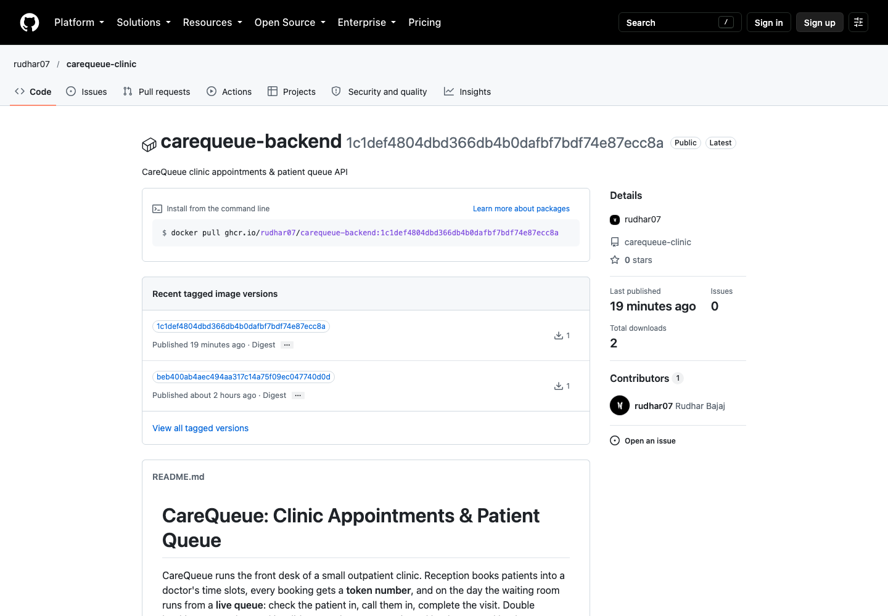 | 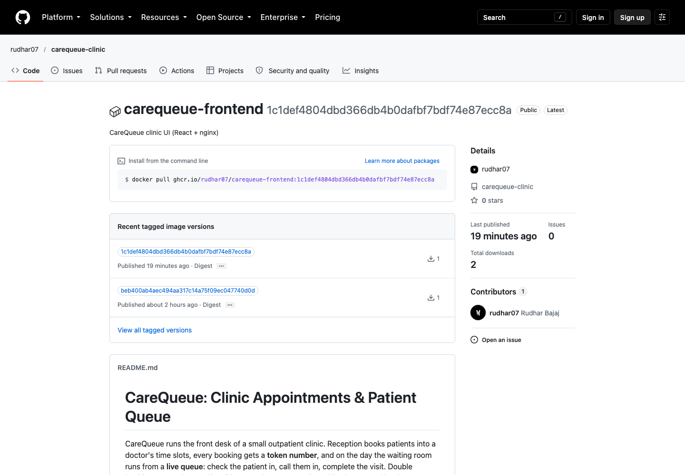 |

Commit history on `main`: 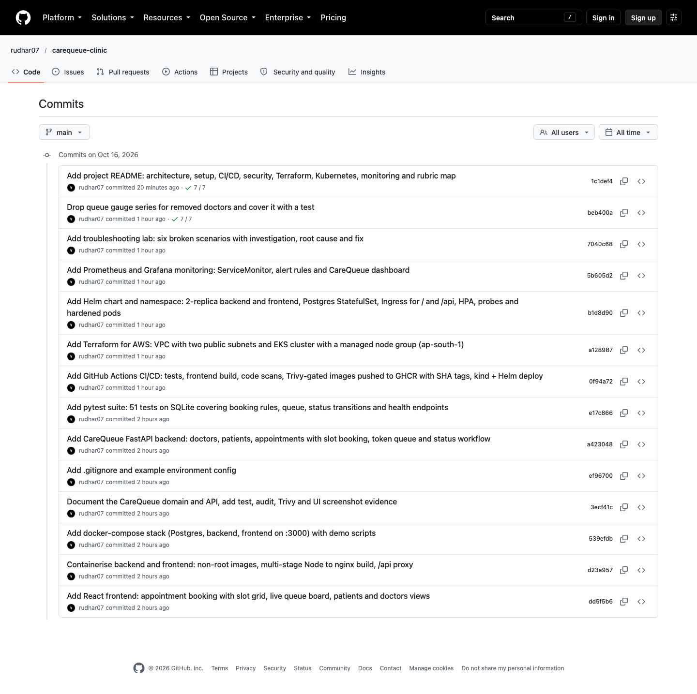

## 6. Security scanning

| Tool | What it scans | Gate |
|---|---|---|
| Trivy (image) | OS packages and libraries in both images | fails on **HIGH/CRITICAL** with a fix available (`--ignore-unfixed --exit-code 1`) |
| Trivy (config) | Terraform misconfigurations | reviewed; 5 deliberate trade-offs suppressed inline with reasons |
| Gitleaks | secrets in files and git history | any finding fails |
| Bandit | Python SAST | MEDIUM+ severity and confidence fails |
| pip-audit / npm audit | known CVEs in dependencies | any finding (high+ for npm) fails |

**What Trivy found:** it scanned the backend image (Debian 13 + Python packages) and the frontend
image (Alpine + nginx) for known vulnerabilities. The result was **0 HIGH/CRITICAL findings with an
available fix in either image**, so the gate passed. The backend base image does carry HIGH CVEs in
Debian packages that have no patched version yet; `--ignore-unfixed` reports them without blocking,
because no upgrade exists to apply. The gate does work: an old `nginx` image made it exit 1
([ci-05](docs/evidence/ci-05-docker-trivy-steps.txt)). Local scan: [08-trivy-images.txt](docs/evidence/08-trivy-images.txt).

**Trivy step output in the pipeline** (run 38937999333, steps "Trivy scan summary" and "Trivy gate").
GitHub only shows job logs to signed-in users, so these were taken from the job logs through the
Actions API (`gh api repos/rudhar07/carequeue-clinic/actions/jobs/<id>/logs`):
[backend](docs/evidence/ci-07-actions-trivy-backend.txt), [frontend](docs/evidence/ci-07-actions-trivy-frontend.txt).

| Backend image: Trivy gate | Frontend image: Trivy gate |
|---|---|
| 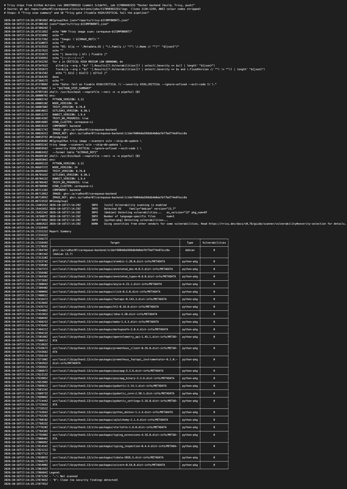 | 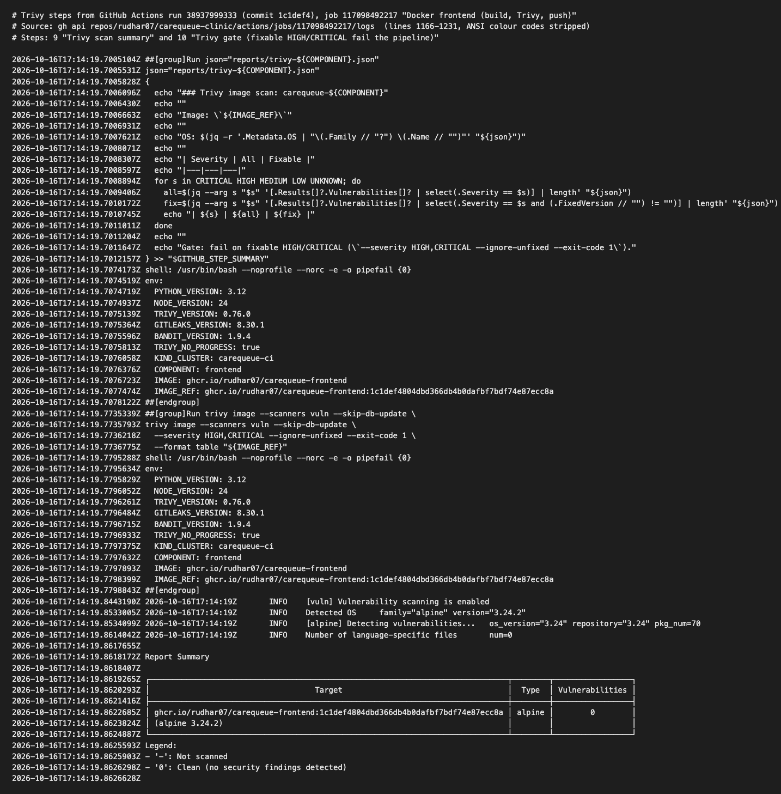 |

## 7. Terraform: AWS VPC + EKS

[terraform/](terraform/) creates:
- a VPC `10.0.0.0/16` with **two public subnets in two AZs**, an internet gateway and routes;
- an **EKS** cluster (1.36) with **one managed node group** (2× t3.medium, min 1, max 3), in
  `ap-south-1`.

There's no NAT gateway, to keep the lab cheap; `enable_private_subnets=true` switches on the
production layout. `terraform.tfvars.example` holds only non-secret settings, and no credentials
are ever committed. The full runbook (plan → apply → kubeconfig → console checks → destroy, plus
cost) is in [docs/TERRAFORM.md](docs/TERRAFORM.md).

Offline checks: fmt, validate, tflint and a Trivy config scan, all clean ([tf-01…tf-03](docs/evidence/)).
A plan against a local AWS mock produced 51 resources ([tf-04](docs/evidence/tf-04-plan-against-local-mock.txt)).

**AWS run (plan, apply, Console, destroy):** done on a real AWS account in ap-south-1, on 2026-10-17
(account IDs masked in the transcripts).

1. `terraform init` + `plan`: **51 to add** ([tf-aws-01](docs/evidence/tf-aws-01-init-plan.txt)).
2. `terraform apply`: the VPC, subnets and EKS control plane came up, but the node group got no
   nodes. The account is on the **AWS Free plan**, which only launches free-tier instance types, and
   Auto Scaling reported *"The specified instance type is not eligible for Free Tier"* for `t3.medium`.
   The apply was stopped, the local `terraform.tfvars` was set to `node_instance_types =
   ["m7i-flex.large"]` (free-tier eligible, 2 vCPU / 8 GiB), and a second apply replaced the node group
   ([tf-aws-02](docs/evidence/tf-aws-02-apply.txt)). The committed default stays `t3.medium` for a
   normal paid account.
3. `kubectl get nodes`: **2 nodes Ready**, Kubernetes v1.36 ([tf-aws-03](docs/evidence/tf-aws-03-kubectl-get-nodes.txt)).
4. `terraform destroy`: started right after step 3; the EC2 nodes were already terminated when this
   was committed, and the cluster and VPC deletion was still in progress.

| Plan | VPC in the Console | EKS cluster in the Console |
|---|---|---|
| 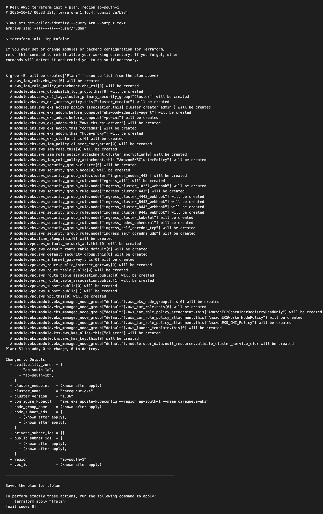 | 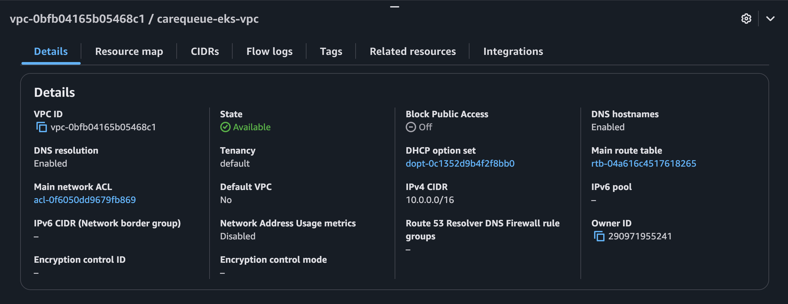 | 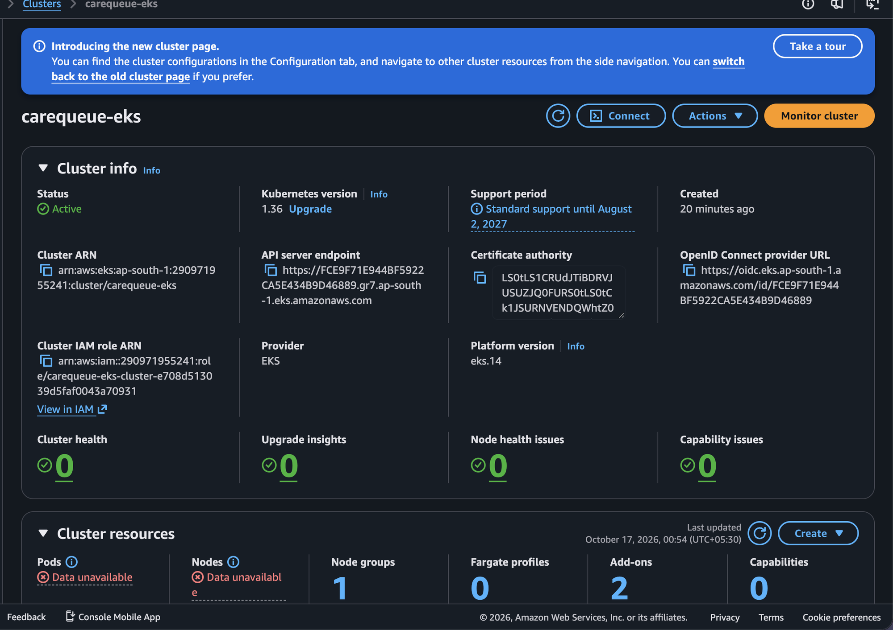 |

`kubectl get nodes` on EKS: 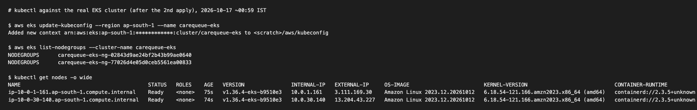

An earlier attempt from a different AWS account was blocked by an AWS Organizations SCP
([tf-05](docs/evidence/tf-05-real-aws-plan-blocked-by-scp.txt)); nothing was created there.

## 8. Kubernetes + Helm

- [k8s/namespace.yaml](k8s/namespace.yaml): the `carequeue` namespace, with Pod Security `restricted`.
- [helm/carequeue/](helm/carequeue/): Chart, `values.yaml`, `values-dev.yaml`, `values-prod.yaml`
  and 16 templates.
  - Backend and frontend Deployments with **2 replicas each**, probes, resource requests/limits,
    non-root and read-only root filesystems.
  - **ClusterIP Services**.
  - **Ingress**: `/` → frontend, `/api` → backend.
  - **HPA**: backend 2–6, frontend 2–4.
  - PostgreSQL StatefulSet with a PVC; migration and seed Jobs; PDBs.
  - ServiceMonitor and PrometheusRule.
  - A `helm test` pod.

```bash
./scripts/kind-up.sh            # kind cluster + ingress-nginx + metrics-server
./scripts/deploy-local.sh       # build images, load into kind, helm upgrade --install
kubectl get pods,svc,ingress -n carequeue
helm list -n carequeue
```

| `kubectl get pods` | `kubectl get svc,ingress` | `helm list` |
|---|---|---|
| 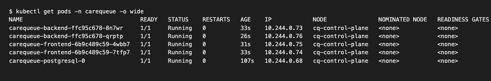 | 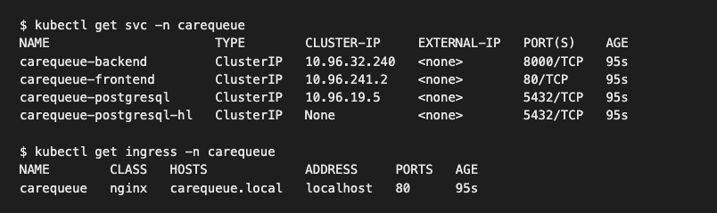 | 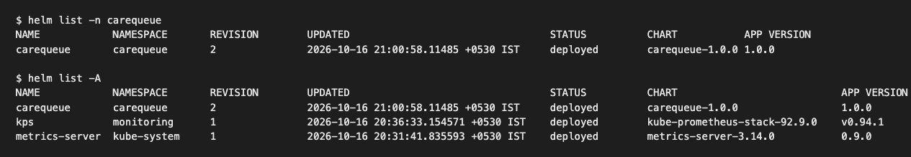 |

The app through the Ingress (`Host: carequeue.local`):
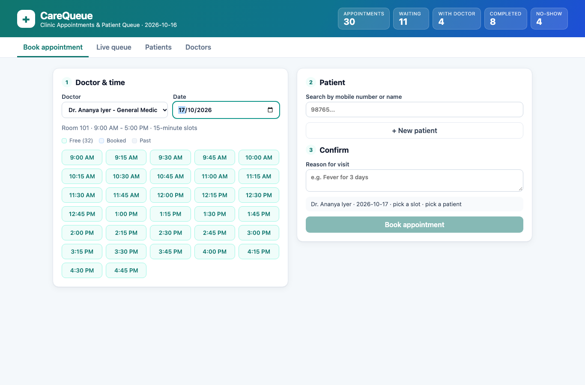

**Autoscaling:** under `scripts/load-test.sh` the backend HPA scaled **2 → 4 → 6**, then back to 2
about 90 s after the load stopped (`values-dev.yaml` sets a 60 s scale-down window for the demo).
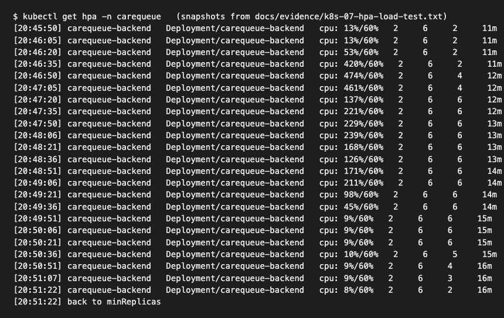

Evidence: [k8s-02 deploy](docs/evidence/k8s-02-deploy-local.txt), [k8s-04 ingress + API](docs/evidence/k8s-04-ingress-api-flow.txt),
[k8s-05 status + helm test](docs/evidence/k8s-05-status-and-helm-test.txt), [k8s-07 HPA](docs/evidence/k8s-07-hpa-load-test.txt),
and [k8s-08: the CI deploy job replayed verbatim](docs/evidence/k8s-08-ci-deploy-job-replay.txt).

## 9. Monitoring: Prometheus + Grafana

- `/metrics` exposes HTTP request count, latency and status codes, plus clinic metrics:
  `carequeue_appointments_booked_total`, `carequeue_appointments_status_total{status}` and
  `carequeue_queue_waiting{doctor}`.
- [monitoring/kube-prometheus-stack-values.yaml](monitoring/kube-prometheus-stack-values.yaml) installs
  Prometheus + Grafana. The chart's ServiceMonitor makes Prometheus scrape the backend, and 3 alert
  rules ship in the chart (backend down, high 5xx rate, long queue).
- [monitoring/grafana-dashboard-carequeue.json](monitoring/grafana-dashboard-carequeue.json): 15 panels
  (request rate, p95 latency, error rate, bookings, queue per doctor, CPU/memory, HPA replicas).

| Prometheus targets (carequeue UP) | Grafana dashboard |
|---|---|
| 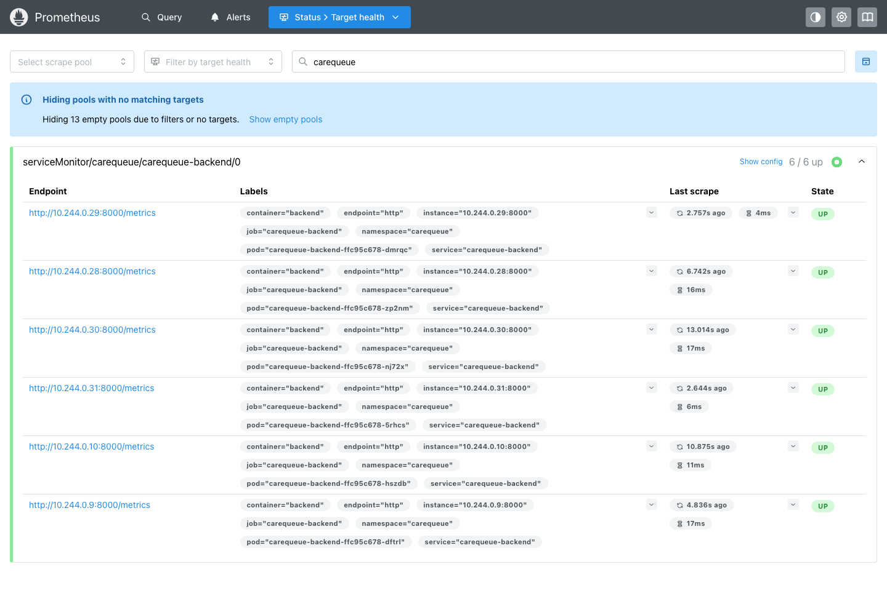 | 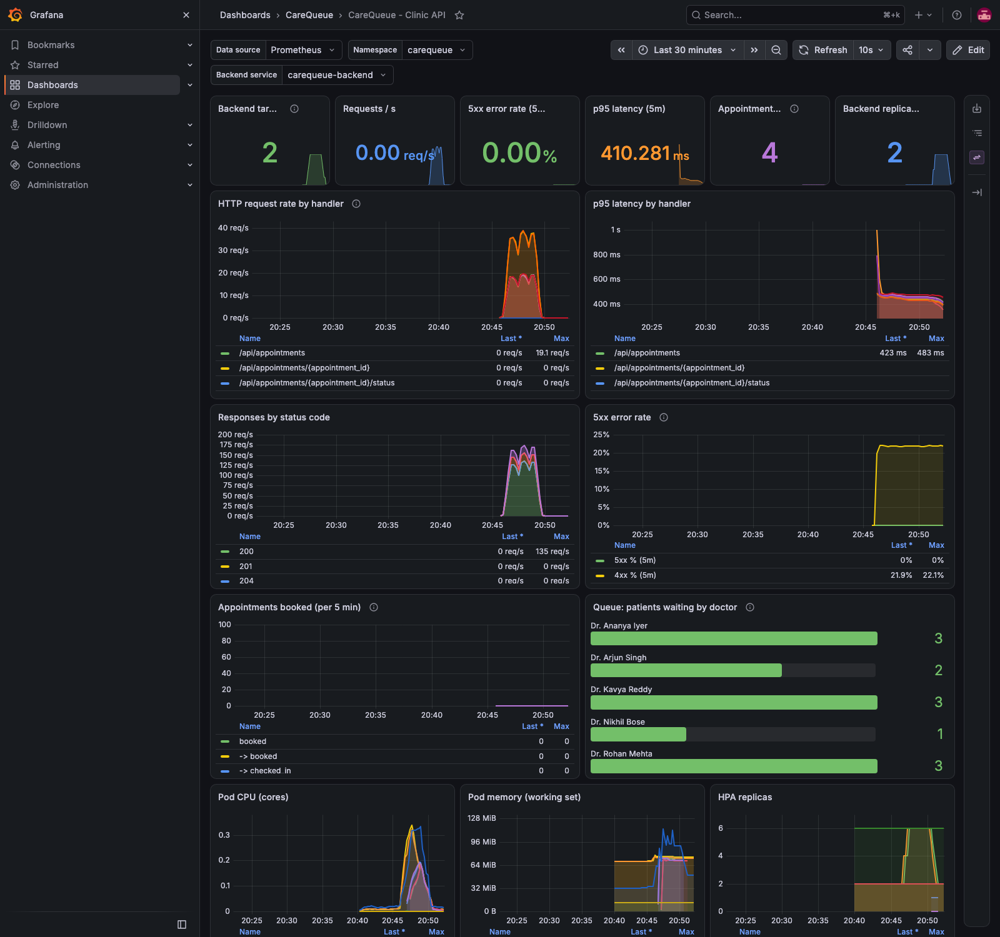 |

`curl /metrics`: 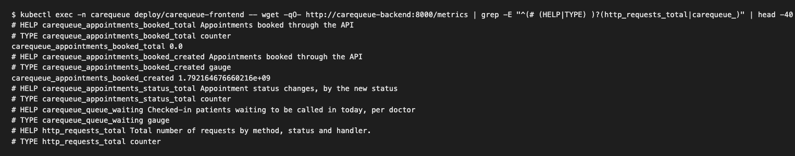

Evidence: [mon-02 targets + PromQL](docs/evidence/mon-02-prometheus-targets-and-promql.txt), [mon-03 Grafana](docs/evidence/mon-03-grafana.txt).

## 10. Troubleshooting lab

[troubleshooting/README.md](troubleshooting/README.md) has six faults I broke on purpose and fixed on a
real cluster. For each: the symptom, the commands I used to investigate, the root cause, the fix,
and the verification.

| # | Fault | Symptom |
|---|---|---|
| 1 | wrong image tag | `ImagePullBackOff` |
| 2 | wrong `DATABASE_URL` | Running but 0/1 Ready, `/ready` 503 |
| 3 | Service selector mismatch | no endpoints, 503 at the Ingress |
| 4 | Ingress → missing Service | 503 |
| 5 | no CPU requests | HPA targets `<unknown>` |
| 6 | wrong liveness path | restart loop, fixed with `helm rollback` |

## 11. Rubric map

| Module | Where |
|---|---|
| M1 Application | `backend/app/`, `backend/alembic/versions/0001_create_clinic_tables.py`, `frontend/src/`, `docker-compose.yml`, screenshots in section 2 |
| M2 Testing | `backend/tests/`, `backend/pytest.ini`, `backend/tests/conftest.py`, [10-pytest-v.txt](docs/evidence/10-pytest-v.txt), `pytest -v` screenshot in section 4 |
| M3 Git/GitHub | this public repo, commit history ([screenshot](docs/screenshots/ci-04-commit-history.png)), [.gitignore](.gitignore) (`.env`, `__pycache__`, `node_modules`, `.venv`) |
| M4 Docker | `backend/Dockerfile`, `frontend/Dockerfile` (multi-stage), non-root ([07](docs/evidence/07-nonroot.txt)), compose ([05](docs/evidence/05-compose-up.txt), [11](docs/evidence/11-compose-localhost-3000.txt), `localhost:3000` screenshots in section 3) |
| M5 CI/CD | `.github/workflows/ci-cd.yml`, green run links and screenshots in section 5, GHCR packages with SHA tags (screenshots in section 5) |
| M6 DevSecOps | Trivy steps in the workflow, explanation and pipeline Trivy output in section 6 |
| M7 Terraform | `terraform/`, `terraform.tfvars.example`, [docs/TERRAFORM.md](docs/TERRAFORM.md), real AWS plan, apply, Console screenshots and `kubectl get nodes` in section 7 |
| M8 Kubernetes + Helm | `k8s/namespace.yaml`, `helm/carequeue/`, section 8 screenshots |
| M9 Observability | `/metrics`, `monitoring/`, section 9 screenshots |
| M10 Docs + demo | this README; live demo: commit a change → pipeline → new SHA deployed |

## 12. Repository layout

```
.github/workflows/ci-cd.yml   CI/CD pipeline
backend/                      FastAPI app, Alembic migration, pytest suite, Dockerfile
frontend/                     React + Vite app, Vitest tests, nginx template, Dockerfile
docker-compose.yml            local stack (UI on :3000)
k8s/                          namespace + kind config + bootstrap order
helm/carequeue/               Helm chart (values-dev / values-prod)
terraform/                    AWS VPC + EKS
monitoring/                   kube-prometheus-stack values + Grafana dashboard
troubleshooting/              6 broken scenarios + write-up
scripts/                      kind-up, deploy-local, monitoring-up, load-test, api-flow, screenshots
docs/                         APP, CICD, TERRAFORM guides; evidence/ transcripts; screenshots/
```
