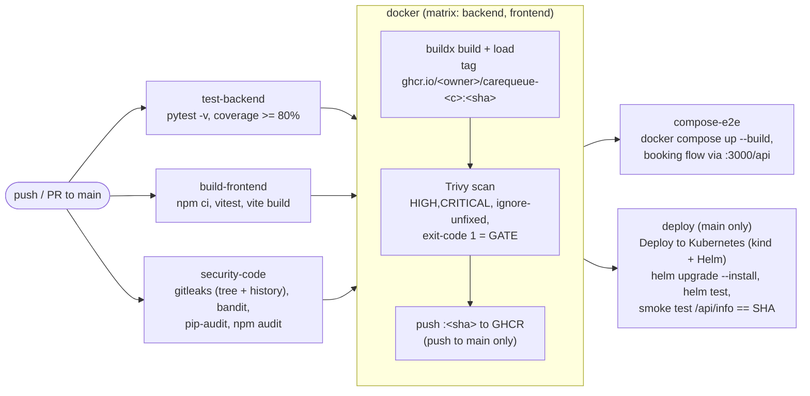

# CI/CD: GitHub Actions pipeline (M5) + Trivy gate (M6)

One workflow, `.github/workflows/ci-cd.yml`, tests, builds, scans, publishes and deploys CareQueue on every push to `main`.

- **Triggers:** `push` to `main`, `pull_request` to `main`, and `workflow_dispatch` (the "Run workflow" button).
- **Permissions:** `contents: read` for the whole workflow. Only the `docker` job gets `packages: write` (to push to
  GHCR), and `deploy` gets `packages: read`. No personal tokens or repository secrets are needed: everything uses the
  automatic, short-lived `GITHUB_TOKEN`.
- **Concurrency:** a new push to a PR cancels that PR's older run. Runs on `main` are never cancelled halfway, so they
  queue and each push/deploy completes.

## Pipeline

A failure anywhere stops what depends on it: a failing test, a leaked secret, a vulnerable dependency or a fixable
HIGH/CRITICAL CVE means **no image is pushed and nothing is deployed**.

## Jobs

| # | Job (name in the UI) | Needs | What it does | Fails the build when |
|---|---|---|---|---|
| 1 | `test-backend` (Backend tests (pytest + coverage)) | none | Python 3.12, `pip install -r backend/requirements-dev.txt`, `cd backend && pytest -v --cov=app --cov-report=xml --cov-fail-under=80`. Uploads `backend-test-reports` (JUnit XML + coverage.xml). | any test fails, or coverage < 80% |
| 2 | `build-frontend` (Frontend tests + build) | none | Node 24 with npm cache on `frontend/package-lock.json`; `npm ci`, `npm test -- --run` (vitest), `npm run build`. Uploads `frontend-dist`. | a unit test or the build fails |
| 3 | `security-code` (Code security) | none | gitleaks 8.30.1 (release binary, sha256-verified) on the working tree **and the full git history**, with `--redact`; bandit 1.9.4 (`bandit[sarif]`): JSON+SARIF reports, then a MEDIUM+ gate; pip-audit on `backend/requirements.txt`; `npm audit --omit=dev --audit-level=high`. Uploads `security-code-reports`. | any secret, a MEDIUM+ bandit issue, any known-vulnerable Python dependency, a high/critical npm advisory in a production dependency |
| 4 | `docker` (Docker backend / frontend) | 1, 2, 3 | Matrix over `backend` and `frontend`. Buildx build (GHA layer cache), loaded locally and tagged `ghcr.io/<owner>/carequeue-<component>:<sha>`. Trivy 0.76.0 (sha256-verified): JSON + SARIF reports, a scan summary in the run summary, then the **gate**. Then, on push to `main` only: log in to GHCR with `GITHUB_TOKEN` and push the **same, scanned image**, SHA tag only. Uploads `trivy-backend` / `trivy-frontend`. | build fails; **Trivy finds a HIGH or CRITICAL CVE that has a fix** |
| 5 | `compose-e2e` (Compose end-to-end) | 4 | `docker compose up -d --build`, waits for `http://localhost:3000/api/info`, then a real flow through the nginx proxy: create doctor → create + update patient → book tomorrow 10:00 (token assigned) → double-book same slot = **409** → slot grid shows it booked → cancel → delete = 204 → GET = 404; checks `/api/info` commit == SHA. | any step of the flow |
| 6 | `deploy` (**Deploy to Kubernetes (kind + Helm)**) | 4 | Push to `main` only. kind cluster (port 80 mapped), ingress-nginx, namespace `carequeue` + `ghcr` imagePullSecret (from `GITHUB_TOKEN`), `helm upgrade --install carequeue helm/carequeue` with the SHA tags, `kubectl rollout status`, `helm test --logs`, smoke test through the ingress: `/api/info` commit must equal `$GITHUB_SHA` (with `Host: carequeue.local` and on plain `localhost`). | install/rollout fails, helm test fails, or the running commit is not this commit |

Proven patterns reused from the earlier TaskBoard pipeline (green on GitHub): release binaries with sha256 checks
instead of third-party actions for gitleaks/Trivy, `bandit[sarif]` for SARIF output, `persist-credentials: false` on
every checkout, report artifacts on `if: always()`, and a Helm test hook with `hook-delete-policy: before-hook-creation`
so `helm test --logs` can read the logs.

## How SHA tagging works

- `${{ github.sha }}` / `$GITHUB_SHA` is the full 40-character commit ID that triggered the run.
- The image name is built from the repository **owner**, lowercased (GHCR rejects uppercase):
  `ghcr.io/${GITHUB_REPOSITORY_OWNER,,}/carequeue-<component>`. For this repo that is
  `ghcr.io/rudhar07/carequeue-backend:<sha>` and `ghcr.io/rudhar07/carequeue-frontend:<sha>`. A fork pushes
  to its own owner's namespace automatically.
- **Only the SHA tag is pushed, never `latest`.** Every image therefore maps to exactly one commit, a rollback is
  `helm upgrade … --set-string backend.image.tag=<older sha>`, and nothing is silently overwritten.
- The same SHA is baked in as `GIT_SHA` (build-arg → env), so `GET /api/info` returns `{"commit": "<sha>"}`. The
  deploy job compares that against `$GITHUB_SHA`, which proves the cluster runs the commit you just pushed. That's
  the live demo for M10: commit, watch the run, see `/api/info` change.
- The pushed image is the exact image Trivy scanned (built once, `load: true`, scanned, then `docker push`); it is
  never rebuilt between scan and push.
- Pull requests build and scan the images but do not push them.

## Reading the Trivy results

Where to look in a run:
1. **Run summary page** (the run's top page): one "Trivy image scan: carequeue-backend / -frontend" table per image
   with the CVE counts per severity, "All" vs "Fixable", plus the OS that was detected.
2. **Job `Docker backend` / `Docker frontend` → step "Trivy gate (fixable HIGH/CRITICAL fail the pipeline)"**: the
   table output. A clean gate shows each target with `0`. A failing gate lists Library, Vulnerability (CVE ID),
   Severity, Installed and Fixed Version, and the step ends with exit code 1. **Screenshot this step for M6.**
3. **Artifacts `trivy-backend` / `trivy-frontend`**: `trivy-<c>.json` (everything, all severities, including
   unfixed) and `trivy-<c>.sarif`.

What the gate means: `--severity HIGH,CRITICAL --ignore-unfixed --exit-code 1` fails the pipeline only for HIGH or
CRITICAL vulnerabilities that **have a fixed version available**, because those are the ones you can act on
(upgrade the base image or package). CVEs the distribution has not fixed yet stay visible in the JSON and in the
summary's "All" column but do not block, since no rebuild could remove them.

When the gate fails: open the table, find the package and its "Fixed Version", then (a) bump the base image
digest in the Dockerfile, (b) for Python/npm packages, bump the pin in `requirements.txt`/`package-lock.json`, or
(c) for Alpine/Debian packages, rebuild (the frontend Dockerfile runs `apk upgrade`).

What a local run of the same steps showed on 2026-10-16 (`docs/evidence/ci-05-docker-trivy-steps.txt`, current code, local
build): **backend** (Debian 13 / python:3.13-slim): 0 CRITICAL, 44 HIGH, **0 fixable**, so the gate passes. The HIGHs are in
base-OS packages such as `util-linux`/`libblkid1`/`libmount1`, still "affected" (no fix published). **frontend** (Alpine,
nginx-unprivileged): 0 vulnerabilities. The same gate pointed at an old image (`nginx:1.21.0-alpine`) fails with
61 fixable HIGH/CRITICAL and exit code 1, which shows it really blocks. Your CI numbers will differ as the CVE database updates.

### Template: "what Trivy scanned and what the result means" (fill in after your first green run)

> In run [#__](https://github.com/rudhar07/carequeue-clinic/actions/runs/________) Trivy ____ scanned the two images built from
> commit `_______`: `ghcr.io/rudhar07/carequeue-backend` (Debian ___ base + the Python packages from requirements.txt) and
> `ghcr.io/rudhar07/carequeue-frontend` (Alpine ___ nginx-unprivileged + the built React files), checking OS packages and
> application libraries against its vulnerability database. The backend had __ CRITICAL / __ HIGH findings, of which __ had a
> fix available; the frontend had __ / __ (__ fixable). Because the gate fails only on *fixable* HIGH/CRITICAL CVEs and there
> were __ of them, the pipeline [passed / failed], so these images were [pushed / blocked]. For example, ______ (CVE-____-_____)
> in package ______ ______ [is unfixed in Debian, so it is reported but cannot be patched by rebuilding yet / was fixed by …].

(If both images are clean, say so: "0 fixable HIGH/CRITICAL, so the gate passed; the remaining N findings are unfixed upstream or below HIGH.")

## What to screenshot for the rubric

| Rubric item | Screenshot |
|---|---|
| M5 green pipeline | Actions → the run on `main` → the graph with all jobs green (test-backend, build-frontend, security-code, Docker backend, Docker frontend, compose-e2e, Deploy to Kubernetes). Also copy the **run URL** into the submission form. |
| M5 pytest in CI | Job `test-backend` → step "pytest" expanded, showing `… passed` and `Required test coverage of 80% reached`. |
| M5 images in GHCR with SHA tags | `https://github.com/rudhar07?tab=packages` → `carequeue-backend` and `carequeue-frontend` → the package page listing the 40-character SHA tag(s) (and the `docker pull ghcr.io/rudhar07/carequeue-backend:<sha>` line). |
| M6 Trivy output | Job `Docker backend` (and frontend) → step "Trivy gate" table, plus the run summary's Trivy tables. |
| M10 live demo | Push a small visible change → the run → deploy job "Smoke test" step printing `/api/info` with the new commit. |

## GitHub settings

Nothing beyond defaults is required:
- **Actions enabled** for the repository (default for a new public repo). Settings → Actions → General → "Allow all
  actions". The workflow declares its own `permissions:`, so the default *read* workflow-permission setting is fine.
- **GHCR packages** are created automatically by the first push to `main`, as **private**, and linked to the repo through
  the `org.opencontainers.image.source` label. CI pulls them with `GITHUB_TOKEN`, so they can stay private.
  *Optional:* make them **public** (package page → Package settings → Change visibility → Public) so anyone, including
  the grader and an EKS cluster without a pull secret, can `docker pull` them.
- If a push ever fails with `403 Forbidden` (for example because a package with that name was created earlier from another repo):
  package page → Package settings → **Manage Actions access** → add `carequeue-clinic` with the **Write** role.

## Contract with the Helm chart (`helm/carequeue`)

The deploy job sets exactly these values; the chart must accept them:

| Key | Type | Set by CI to |
|---|---|---|
| `backend.image.repository` | string | `ghcr.io/<owner>/carequeue-backend` |
| `backend.image.tag` | string (`--set-string`) | `$GITHUB_SHA` |
| `frontend.image.repository` | string | `ghcr.io/<owner>/carequeue-frontend` |
| `frontend.image.tag` | string (`--set-string`) | `$GITHUB_SHA` |
| `imagePullSecrets` | list of `{name}` | `[{name: ghcr}]` (secret type `kubernetes.io/dockerconfigjson`, created by CI in namespace `carequeue`) |
| `ingress.enabled` | bool | `true` |
| `ingress.className` | string | `nginx` |
| `ingress.host` | string | `carequeue.local` (the chart must also keep a host-less rule so plain `http://localhost/` works) |
| `postgresql.enabled` | bool | `true` (in-cluster PostgreSQL) |
| `backend.env.GIT_SHA` | string (`--set-string`) | `$GITHUB_SHA` (rendered as the backend container's `GIT_SHA` env, returned by `/api/info`) |

Plus: a `helm test` hook pod with `helm.sh/hook-delete-policy: before-hook-creation`; release `carequeue`, namespace
`carequeue`; Deployments that become Ready within the job's `--wait --timeout 8m`.

## Local verification (what was actually run before the first push)

The workflow had not run on GitHub yet when this was written. The following were run locally and recorded,
with each command echoed as `$ cmd`:

| Evidence | What it shows |
|---|---|
| `docs/evidence/ci-01-actionlint.txt` | actionlint 1.7.12 + shellcheck 0.11.0: no findings |
| `docs/evidence/ci-02-install-steps-ubuntu-amd64.txt` | the gitleaks and Trivy install steps, extracted verbatim, run in `ubuntu:24.04` linux/amd64: both checksums `OK`, and a tampered tarball is rejected |
| `docs/evidence/ci-03-security-code-local.txt` | gitleaks dir: no leaks; bandit MEDIUM+ gate: clean; pip-audit: no known vulnerabilities; npm audit: 0 vulnerabilities (the gitleaks *history* scan was not run locally because there is no history yet) |
| `docs/evidence/ci-04-test-and-build-local.txt` | the exact pytest command: 51 passed, coverage 96%; then with a deliberately failing test added (scratch copy) the same command exits 1. Frontend: `npm ci`, vitest 11 passed, vite build OK |
| `docs/evidence/ci-05-docker-trivy-steps.txt` | image-name, inspect, Trivy report/summary/gate steps (verbatim) in ubuntu amd64 against locally built images: owner lowercased, non-root users 10001/101, gate passes; the same gate on an old image fails with exit 1 |
| `docs/evidence/ci-06-compose-e2e-local.txt` | the compose booking flow (verbatim, different host port), against the real compose stack: `Compose end-to-end OK` |
| `docs/evidence/ci-07-deploy-job-kind-local.txt` | the deploy job's steps (verbatim) on a local kind cluster with a **scratch stand-in chart** that implements only the values contract above: rollout, `helm test`, ingress smoke test with commit match. Two bugs found and fixed in the ingress-nginx wait logic. |

Not verifiable locally: the GHCR login/push (it needs GitHub's `GITHUB_TOKEN`), `actions/*` caching, and the real
Helm chart (written separately). The first real run on GitHub is the final proof.
