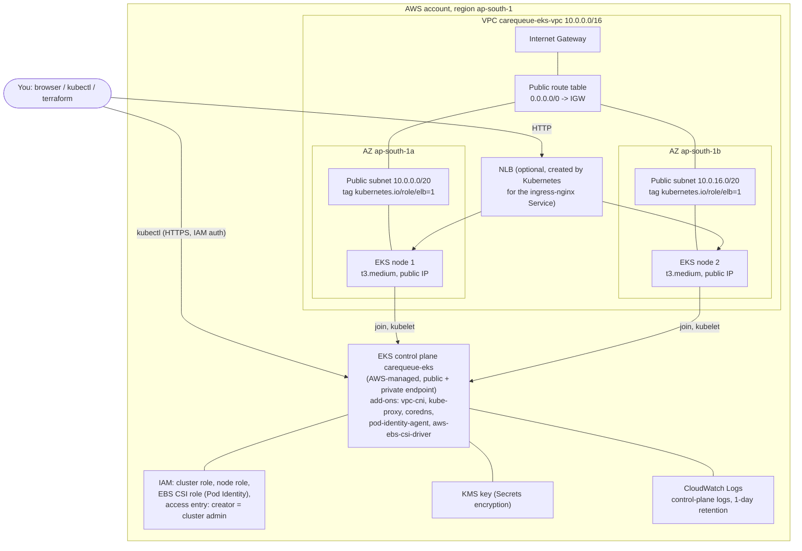

# Terraform: AWS VPC + EKS for CareQueue (M7)

`terraform/` provisions a small but real AWS footprint in **ap-south-1 (Mumbai)**:

- a **VPC** `10.0.0.0/16` with **2 public subnets in 2 Availability Zones**, an Internet Gateway and a public route table, and
- an **EKS cluster** (Kubernetes 1.36) with **one managed node group** (2 x `t3.medium`, scales between 1 and 3).

It is built for a short-lived lab: you `apply`, take the screenshots, optionally demo the app, then `destroy`, all within about 1 to 2 hours.

> **Status of this code (be honest in the presentation):** everything that works without AWS credentials
> has been run and recorded in `docs/evidence/tf-*.txt` (`fmt`, `init`, `validate`, `tflint`, Trivy IaC scan,
> and a `terraform plan` against a **local AWS API mock**, not real AWS). The real `plan`, `apply` and `destroy`
> against AWS are **your** steps below, with your own credentials. Nothing has been applied to AWS yet.

---

## 1. Architecture



| File | What it holds |
|---|---|
| `versions.tf` | Terraform `>= 1.6.0`, AWS provider `~> 6.69` (lock file pins 6.69.1) |
| `providers.tf` | region from `var.region` (default `ap-south-1`), `default_tags` Project=CareQueue, Owner=rudhar07, ManagedBy=Terraform. **No credentials.** |
| `variables.tf` | every input, with types, defaults and validation |
| `main.tf` | AZ lookup, locals (where the nodes go) |
| `vpc.tf` | `terraform-aws-modules/vpc/aws` `~> 6.7` (6.7.3) |
| `eks.tf` | `terraform-aws-modules/eks/aws` `~> 21.29` (21.29.0) + EBS CSI IAM role |
| `outputs.tf` | cluster name, endpoint, version, region, VPC ID, subnet IDs, node group name, the `aws eks update-kubeconfig` command |
| `terraform.tfvars.example` | sample inputs (region, names, sizes). No credentials, ever. |
| `.terraform.lock.hcl` | committed; provider versions + hashes for darwin_arm64, darwin_amd64, linux_amd64 |
| `.tflint.hcl`, `.gitignore` | lint config; ignores state, `.terraform/`, `terraform.tfvars`, plan files |

### Design decisions (and why)

- **Official modules** (`terraform-aws-modules/vpc` and `/eks`) instead of hand-written resources. They are the
  most-used, battle-tested AWS modules, and they get the many small EKS details right: security-group rules,
  add-on ordering, the launch template and IAM.
- **No NAT gateway (cost).** A NAT gateway costs $0.045/h plus $0.045/GB processed, and it's the single most
  expensive "idle" item in a small lab. Without one, the nodes have to sit in **public subnets with a public
  IPv4 address** (`map_public_ip_on_launch = true`) so they can pull images and reach the EKS API.
  - *What this costs in security:* the nodes have public IPs. Inbound traffic is still blocked: the node
    security group only allows the control plane and other nodes in. Production clusters put nodes in private
    subnets.
  - *The production layout is one variable away:* `enable_private_subnets = true` adds 2 private subnets
    (10.0.128.0/20, 10.0.144.0/20), 1 NAT gateway + Elastic IP, a private route table, and moves the nodes there.
    The variant was planned against the mock too: 64 resources instead of 51 (`docs/evidence/tf-04-…`).
- **Kubernetes 1.36.** On 2026-10-16 the [EKS version page](https://docs.aws.amazon.com/eks/latest/userguide/kubernetes-versions.html)
  listed 1.37, 1.36, 1.35 and 1.34 in standard support, and 1.33 to 1.31 in (pricier) extended support. 1.36 is
  current, has a long standard-support window left, and matches the kubectl 1.36 on the Mac. 1.37 also works:
  set `kubernetes_version = "1.37"`.
- **`t3.medium`, not `t3.small`.** EKS limits pods per node by ENI/IP capacity: `t3.small` = **11 pods** and
  2 GiB RAM, `t3.medium` = **17 pods** and 4 GiB. Each node already runs 4 system pods (aws-node, kube-proxy,
  ebs-csi-node, pod-identity-agent), and the cluster runs coredns x2 and ebs-csi-controller x2. CareQueue adds 2 backend, 2 frontend,
  PostgreSQL and ingress-nginx; kube-prometheus-stack (M9) adds about 6 to 8 more. That's around 30 pods, so 2 x t3.small
  (22 pod slots, about 3 GiB usable) would not fit, while 2 x t3.medium (34 slots, about 7 GiB) does, with room to spare.
- **ON_DEMAND by default; SPOT optional** (`node_capacity_type = "SPOT"`, ideally with
  `node_instance_types = ["t3.medium", "t3a.medium"]`). Spot is about 60 to 70% cheaper but can be reclaimed with 2 minutes'
  notice. That's fine for a lab, but not what you want mid-presentation.
- **Access entries, not aws-auth.** `authentication_mode = "API"` + `enable_cluster_creator_admin_permissions = true`:
  the IAM identity that runs `apply` is cluster admin, so `kubectl` works right after `update-kubeconfig`.
- **Public endpoint ON** (plus the private endpoint for nodes). kubectl is still authenticated with IAM. To
  narrow it, set `endpoint_public_access_cidrs = ["<your-ip>/32"]`.
- **EBS CSI driver add-on with EKS Pod Identity**, so PostgreSQL PVCs can get EBS volumes. The driver gets its
  own IAM role (`carequeue-eks-ebs-csi`), not node-wide permissions, so IRSA/OIDC isn't needed (`enable_irsa = false`).
- **Hardening that costs (almost) nothing:** KMS envelope encryption of Kubernetes Secrets, encrypted gp3 root
  volumes, IMDSv2 required (hop limit 1), all 5 control-plane log types kept for **1 day only**, and the
  VPC's default security group stripped of all rules.

### Static analysis results (offline)

| Check | Result | Evidence |
|---|---|---|
| `terraform fmt -check -recursive` | clean | `docs/evidence/tf-01-fmt-init-validate.txt` |
| `terraform init -backend=false` | OK (modules vpc 6.7.3, eks 21.29.0, kms 4.0.0; aws provider 6.69.1) | same |
| `terraform validate` | `Success! The configuration is valid.` | same |
| `tflint` 0.64.0 (terraform recommended + aws 0.49.0 rulesets) | 0 issues | `docs/evidence/tf-02-tflint.txt` |
| `trivy config` (Terraform scanner, modules included) | 72 checks passed, 0 failures, 5 accepted with a written reason | `docs/evidence/tf-03-trivy-config.txt` |
| `terraform plan` against a **local moto mock** (not AWS) | `Plan: 51 to add, 0 to change, 0 to destroy.` (private variant: 64) | `docs/evidence/tf-04-plan-against-local-mock.txt` |

The 5 accepted Trivy findings are suppressed inline (`#trivy:ignore:…` comments in `vpc.tf` / `eks.tf`), each with its reason:
AWS-0040/0041 (public API endpoint, open CIDR by default), AWS-0104 (nodes need outbound internet),
AWS-0164 (public IP on launch, which is the no-NAT design), AWS-0178 (flow logs: available via `enable_flow_log = true`).

---

## 2. Runbook

Everything below runs from `carequeue/terraform/`. Times are typical for ap-south-1.

### Step 1: AWS credentials (once)

1. In the AWS Console, create an IAM user (or an IAM Identity Center user) for this lab. For a short-lived lab,
   attaching **`AdministratorAccess`** is acceptable. EKS needs EC2, IAM, EKS, KMS, CloudWatch Logs and SSM read.
   *In production you would grant least privilege instead:* a scoped policy or role for exactly these services,
   ideally assumed via SSO with short-lived credentials, and never long-lived access keys for an admin user.
2. Sign the CLI in, using **one** of these:
   ```bash
   aws login                      # recent AWS CLI v2: browser sign-in, short-lived credentials (preferred)
   # or
   aws configure                  # access key + secret, region ap-south-1, output json
   # or, for IAM Identity Center:
   aws configure sso && export AWS_PROFILE=<profile>
   ```
3. Check who you are, and keep this ARN in mind (it becomes cluster admin):
   ```bash
   aws sts get-caller-identity
   aws configure get region       # should print ap-south-1 (Terraform uses var.region anyway)
   ```

**Never** put keys in `*.tf`, `terraform.tfvars` or anything committed. `providers.tf` deliberately has no
credentials: the provider reads them from the CLI configuration or the environment.

### Step 2: init, fmt, validate, plan, apply

```bash
cd terraform
cp terraform.tfvars.example terraform.tfvars      # gitignored; edit sizes/region here if you want

terraform init                                    # downloads modules + the locked providers
terraform fmt -check -recursive
terraform validate

terraform plan -out=tfplan | tee plan.txt         # plan.txt + tfplan are gitignored
# Expect about "Plan: 51 to add, 0 to change, 0 to destroy." (51 against the mock)  <- SCREENSHOT this (rubric: plan output)

terraform apply tfplan                            # about 15-20 min (EKS control plane is ~10 of them)
terraform output                                  # SCREENSHOT the outputs
```

Then connect kubectl:

```bash
$(terraform output -raw configure_kubectl)
# = aws eks update-kubeconfig --region ap-south-1 --name carequeue-eks

kubectl get nodes -o wide                         # 2 nodes Ready, with EXTERNAL-IP  <- SCREENSHOT
kubectl get pods -A                               # aws-node, kube-proxy, coredns, ebs-csi-*, eks-pod-identity-agent
kubectl get storageclass
```

### Step 3: Console screenshots (rubric: "VPC and EKS cluster in the expected region")

Make sure the region selector (top right) shows **Asia Pacific (Mumbai) ap-south-1** in every screenshot.

1. **VPC → Your VPCs**: `carequeue-eks-vpc`, `10.0.0.0/16`.
2. **VPC → Subnets** (filter by the VPC): the 2 public subnets in **ap-south-1a** and **ap-south-1b**
   (open one and show the *Tags* tab with `kubernetes.io/role/elb = 1`, and *Auto-assign public IPv4 = Yes*).
3. **VPC → Route tables**: the public route table with `0.0.0.0/0 → igw-…`.
4. **EKS → Clusters → carequeue-eks**: status **Active**, Kubernetes version 1.36.
5. **EKS → carequeue-eks → Compute**: the managed node group (`carequeue-eks-ng-…`) with 2 nodes, `t3.medium`, **Active**.
6. Optionally **EC2 → Instances**: the 2 worker instances, with tags `Project=CareQueue`, `ManagedBy=Terraform`.

### Step 4 (optional): run CareQueue on EKS for a cloud demo

Do this only after the Helm chart exists (`helm/carequeue`). The cluster then runs ingress-nginx behind an AWS
**Network Load Balancer**, which the in-tree Kubernetes AWS cloud provider creates from the Service annotation.

```bash
# 0) If `kubectl get storageclass` shows no "(default)" class, create a gp3 default for the PostgreSQL PVC:
cat <<'EOF' | kubectl apply -f -
apiVersion: storage.k8s.io/v1
kind: StorageClass
metadata:
  name: gp3
  annotations:
    storageclass.kubernetes.io/is-default-class: "true"
provisioner: ebs.csi.aws.com
volumeBindingMode: WaitForFirstConsumer
reclaimPolicy: Delete
parameters:
  type: gp3
  encrypted: "true"
EOF

# 1) ingress-nginx with an internet-facing NLB in the public subnets (tagged kubernetes.io/role/elb=1)
helm upgrade --install ingress-nginx ingress-nginx \
  --repo https://kubernetes.github.io/ingress-nginx --version 4.15.1 \
  --namespace ingress-nginx --create-namespace \
  --set controller.service.type=LoadBalancer \
  --set-string controller.service.annotations."service\.beta\.kubernetes\.io/aws-load-balancer-type"=nlb \
  --wait --timeout 10m

# 2) CareQueue images come from GHCR. Simplest: make both packages public (see docs/CICD.md).
#    Otherwise create a pull secret from a classic PAT with ONLY read:packages (never commit it):
#    kubectl create namespace carequeue
#    kubectl -n carequeue create secret docker-registry ghcr --docker-server=ghcr.io \
#      --docker-username=rudhar07 --docker-password="<PAT with read:packages>"
SHA=<full commit SHA of a green main build>       # from the Actions run or the GHCR package page
helm upgrade --install carequeue ../helm/carequeue \
  --namespace carequeue --create-namespace \
  --set-string backend.image.tag="$SHA" --set-string frontend.image.tag="$SHA" \
  --set-string backend.env.GIT_SHA="$SHA" \
  --set ingress.enabled=true --set-string ingress.className=nginx \
  --wait --timeout 10m
#   (add --set "imagePullSecrets[0].name=ghcr" if you created the pull secret)

# 3) Open it: the NLB hostname takes 2-3 minutes to resolve
LB=$(kubectl -n ingress-nginx get svc ingress-nginx-controller -o jsonpath='{.status.loadBalancer.ingress[0].hostname}')
echo "http://$LB/"
curl -s "http://$LB/api/info"                     # commit should equal $SHA
kubectl -n carequeue get pods,svc,ingress         # SCREENSHOT (M8 on real cloud: bonus)
```

The NLB adds about $0.024/h. Remove it **before** `terraform destroy` (step 5).

> ingress-nginx note: the Kubernetes project retired ingress-nginx in March 2026 (the repository is archived and
> controller v1.15.1 is the final release). It still works and is what the course uses. A new project would pick a
> Gateway API implementation instead.

### Step 5: destroy, and prove nothing is left (rubric: destroy screenshot)

**First remove everything Kubernetes created in AWS outside Terraform**, or `destroy` will hang and fail on the VPC:
a `LoadBalancer` Service owns an NLB (plus its ENIs and security group) inside your subnets, and a PVC owns an EBS volume.

```bash
# Skip the helm lines if you did not do step 4.
helm uninstall carequeue -n carequeue --wait || true
kubectl -n carequeue delete pvc --all --wait=true || true       # deletes the EBS volumes (reclaimPolicy Delete)
helm uninstall ingress-nginx -n ingress-nginx --wait || true     # deletes the NLB
kubectl get svc -A | grep LoadBalancer                           # must print nothing
aws elbv2 describe-load-balancers --region ap-south-1 --query 'LoadBalancers[].LoadBalancerName'   # wait until []
```

Then:

```bash
terraform destroy                                 # type "yes"; about 10-15 min
# Expect "Destroy complete! Resources: N destroyed." with N = the number apply created   <- SCREENSHOT
```

Verify (all of these should come back empty, `[]` or `None`):

```bash
R=ap-south-1
aws eks list-clusters --region $R
aws ec2 describe-instances --region $R --filters Name=tag:Project,Values=CareQueue \
  Name=instance-state-name,Values=pending,running,stopping,stopped --query 'Reservations[].Instances[].InstanceId'
aws elbv2 describe-load-balancers --region $R --query 'LoadBalancers[].LoadBalancerArn'
aws ec2 describe-addresses --region $R --query 'Addresses[].PublicIp'
aws ec2 describe-nat-gateways --region $R --filter Name=state,Values=available,pending --query 'NatGateways[].NatGatewayId'
aws ec2 describe-vpcs --region $R --filters Name=tag:Project,Values=CareQueue --query 'Vpcs[].VpcId'
aws ec2 describe-volumes --region $R --filters Name=status,Values=available --query 'Volumes[].[VolumeId,Size,Tags]'
aws logs describe-log-groups --region $R --log-group-name-prefix /aws/eks/carequeue-eks --query 'logGroups[].logGroupName'
```

Notes:
- The KMS key goes to **"Pending deletion"** for 7 days (the minimum AWS allows) and is then deleted. That's
  expected (its cost is at most cents).
- `describe-volumes … available` lists **any** unattached volume in the region. Delete leftovers only if they
  came from this lab (tags such as `kubernetes.io/created-for/pvc/name`).
- Lost the state file, or a destroy that keeps failing? Delete in this order in the Console: LoadBalancers → EKS node group →
  EKS cluster → NAT gateway/EIP (if `enable_private_subnets`) → VPC (deleting the VPC removes its subnets, IGW and route tables).

### Step 6: what it costs (ap-south-1, on-demand, prices checked 2026-10-16)

| Item | Unit price | Default lab (2 nodes) per hour |
|---|---|---|
| EKS control plane (standard support) | $0.10 / cluster-hour | $0.100 |
| 2 x t3.medium Linux on-demand | $0.0448 / instance-hour | $0.090 |
| 2 x 20 GiB gp3 root volumes | $0.0912 / GB-month | $0.005 |
| 2 public IPv4 addresses (one per node) | $0.005 / IP-hour | $0.010 |
| KMS key | $1 / month, prorated | $0.001 |
| CloudWatch control-plane logs (1-day retention) | per GB ingested | a few cents per hour at most |
| **Subtotal** | | **about $0.21 / hour** |
| *Optional:* NLB for ingress-nginx (step 4) | $0.0239 / h + $0.006 / LCU-h | about $0.03 / hour, plus 2 more public IPv4s ($0.01/h) |
| *Optional:* `enable_private_subnets = true` | NAT $0.045 / h + $0.045 / GB, plus its Elastic IP $0.005 / h | +$0.05 / hour + data |

Rough total for one session: **about $0.45 to $0.75** for 2 hours of wall-clock time including the ~20 min create and ~15 min
destroy (both billed), or about $0.25 to $0.35 for 1 hour. Extended-support versions would cost $0.60/h for the control plane
(that's why the code uses 1.36, which is in standard support). T3 instances run in *unlimited* mode, so sustained 100% CPU can
add CPU-credit charges. That doesn't happen with this workload, but don't leave a load test running.

Sources (fetched 2026-10-16):
- EKS: [aws.amazon.com/eks/pricing](https://aws.amazon.com/eks/pricing/) ("$0.10 per hour for each Amazon EKS cluster", standard support; $0.60 extended).
- Public IPv4: [aws.amazon.com/vpc/pricing](https://aws.amazon.com/vpc/pricing/) ("Hourly charge for In-use Public IPv4 Address $0.005").
  NAT gateway $0.045/h and $0.045/GB on the same page.
- EC2 t3.medium (Mumbai, Linux) **$0.0448/h** and EBS gp3 (Mumbai) **$0.0912/GB-month**: the AWS Pricing Calculator
  data feed (`b0.p.awsstatic.com/pricing/2.0/meteredUnitMaps/ec2/…/Asia Pacific (Mumbai)`), the same numbers
  shown on [aws.amazon.com/ec2/pricing/on-demand](https://aws.amazon.com/ec2/pricing/on-demand/).
- NLB (ap-south-1) **$0.0239/h, $0.006/LCU-h**: AWS Price List Bulk API, `offers/v1.0/aws/AWSELB/current/ap-south-1/index.json`
  (publication date 2026-09-11).

Prices change; re-check them before you apply. Set an **AWS Budget** (Billing → Budgets → zero-spend or $5 alert) before you start.

### Step 7: troubleshooting

| Symptom | Cause / fix |
|---|---|
| `VcpuLimitExceeded` / "You have requested more vCPU capacity than your current vCPU limit" | New accounts can have a low On-Demand Standard vCPU quota. 2 x t3.medium = 4 vCPUs (3 nodes = 6). Check **Service Quotas → EC2 → Running On-Demand Standard (A, C, D, H, I, M, R, T, Z) instances** and request an increase, or set `node_desired_size = 1`. |
| Node group stuck *Creating*, then `NodeCreationFailure` / instances never join | The nodes can't reach the EKS API or image registries. Check that the subnets have `MapPublicIpOnLaunch = true` and the route table has `0.0.0.0/0 → IGW` (the module sets both). With `enable_private_subnets = true`, check the NAT gateway. Look at **EKS → Compute → node group → Health issues**. |
| `Unsupported: Your requested instance type (t3.medium) is not supported in your requested Availability Zone` | Pin AZs that support the type: `availability_zones = ["ap-south-1a", "ap-south-1b"]` (or `1c`), or add `t3a.medium` to `node_instance_types`. |
| `AccessDenied` / `UnauthorizedOperation` during plan/apply | The CLI identity lacks permissions (check `aws sts get-caller-identity`, then attach the right policy). Also make sure you are not using an expired SSO session (`aws login` / `aws sso login` again). |
| `kubectl`: `error: You must be logged in to the server (Unauthorized)` or `the server has asked for the client to provide credentials` | kubectl uses a **different** IAM identity than the one that ran `apply` (only the creator got an access entry). Use the same profile, re-run `aws eks update-kubeconfig …`, or add an access entry: `aws eks create-access-entry --cluster-name carequeue-eks --principal-arn <arn>` + `aws eks associate-access-policy … --policy-arn arn:aws:eks::aws:cluster-access-policy/AmazonEKSClusterAdminPolicy --access-scope type=cluster`. |
| `kubectl`: `exec plugin: invalid apiVersion` or `aws: command not found` | Update the AWS CLI to v2 and re-run `update-kubeconfig`. |
| `terraform destroy` hangs on subnets / IGW / VPC (`DependencyViolation`) | Something Kubernetes created still lives in the VPC, usually the NLB of a `LoadBalancer` Service or its ENIs/security group. Delete it (step 5), wait for `describe-load-balancers` to show `[]`, then run `terraform destroy` again. |
| PostgreSQL pod `Pending`, PVC `Pending` (`no persistent volumes available` / no StorageClass) | No default StorageClass: apply the gp3 class from step 4. Check `kubectl -n kube-system get pods -l app.kubernetes.io/name=aws-ebs-csi-driver`. |
| Pods `ImagePullBackOff` from `ghcr.io` | The GHCR packages are private: make them public, or create the `ghcr` pull secret (step 4). |
| `Error: creating EKS Cluster … ResourceInUseException` after an earlier failed run | A cluster with that name is still deleting. Wait, or change `cluster_name`. |
| `terraform init` fails on the lock file (`checksums … do not match`) | Wrong platform, or a hand-edited lock file. Run `terraform providers lock -platform=darwin_arm64 -platform=linux_amd64 -platform=darwin_amd64`. |
